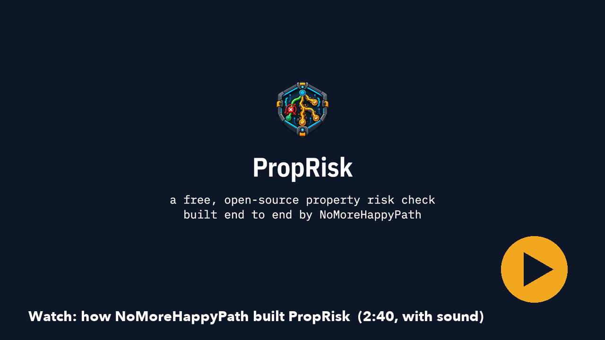
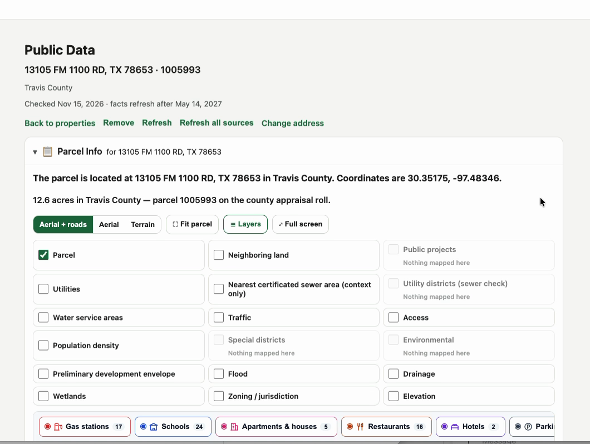
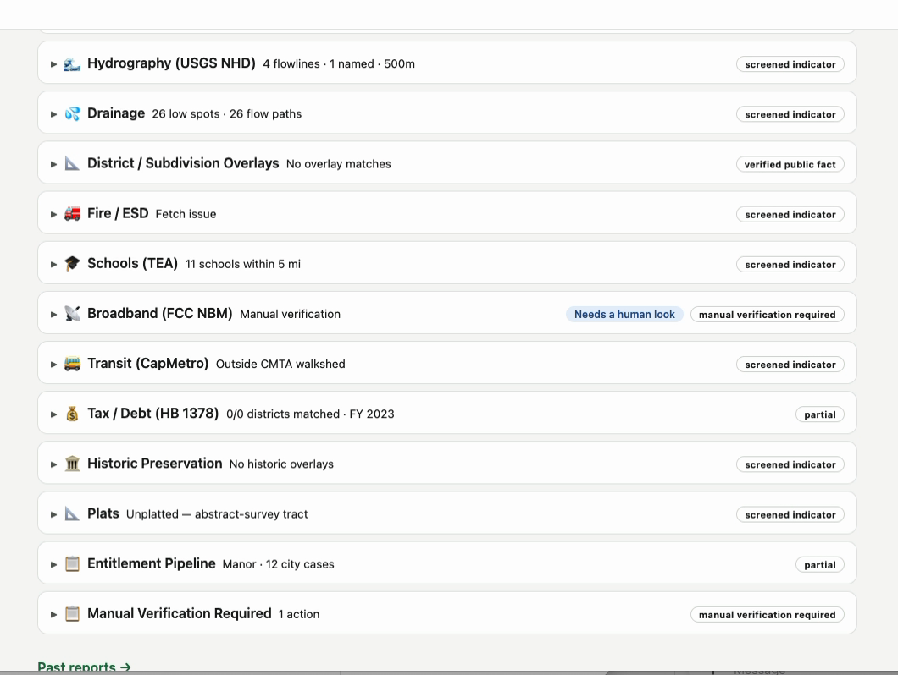
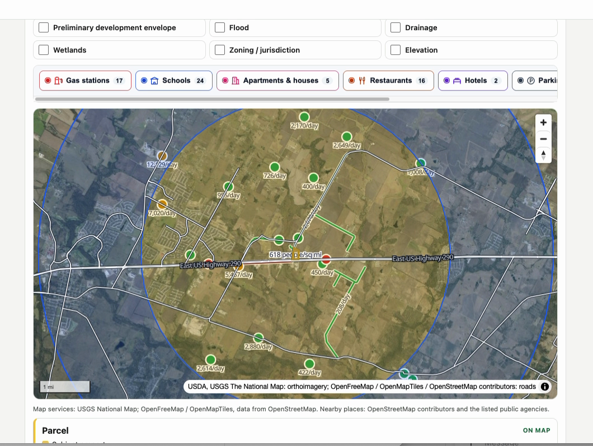
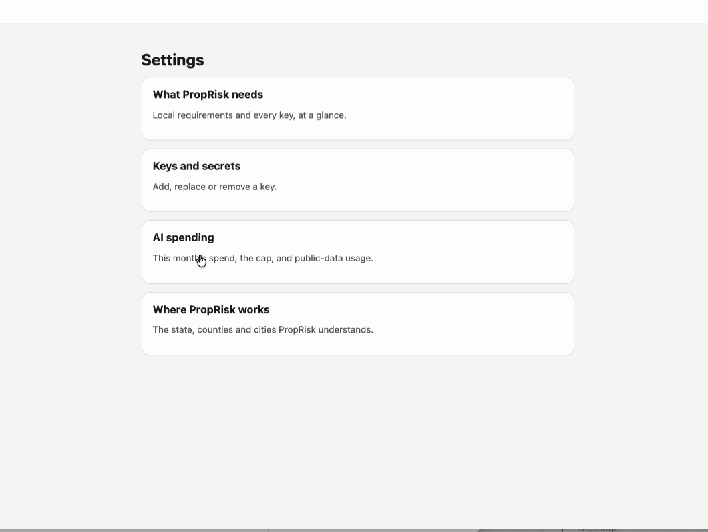

# PropRisk

**Type a Texas address. See what the public record says about the land before you buy it.**

Flood zone, zoning, city limits, traffic counts, roads and bridges, water and sewer
providers, power lines, soils, wetlands, drainage, environmental records, plats,
nearby schools and businesses, demographics, and aerial photos back to 1981, from
38 public sources, in one report and one map. Free, open source, runs on your Mac.

> **Built end to end by [NoMoreHappyPath](https://nomorehappypath.com).**
> The owner wrote one paragraph. NoMoreHappyPath wrote the specification and asked the
> owner the questions that mattered, an independent reviewer from a different AI
> company wrote locked tests before any code, the builder built it, the reviewer tested
> the whole app, and the owner tried it and accepted it.
> [How PropRisk was built →](docs/HOW_IT_WAS_BUILT.md)
>
> *Others give you an AI developer. NoMoreHappyPath gives you the software company.*

<p align="center"><a href="https://nomorehappypath.com/assets/proprisk-demo.mp4"></a></p>

| A lookup | Every finding is a card |
|---|---|
|  |  |
| **The map, with layers** | **Settings: every key optional** |
|  |  |

> **For information only.** PropRisk shows what public records and public data services
> say about a site. It is not legal, survey, title, engineering, environmental or
> appraisal advice, and public data can be out of date or wrong. Check the official
> source, which every card links or names, before you rely on it.

## About

PropRisk is a free, open-source property-lookup tool. Type an address and
it shows what the public record says about the site — flood zone, zoning,
traffic, utilities, soils, wetlands, environmental records, plats, nearby
schools and more — as result cards, a historical-aerial photo gallery, and
an interactive map.

It runs entirely on your own Mac: there is no sign-in, no other account,
and nothing leaves your machine except the lookups you ask it to run
against public data sources (and, optionally, OpenAI, if you add a key).

Today PropRisk understands Texas best, with full coverage in Travis,
Williamson, Hays and Bastrop counties and partial coverage in a few
others, plus Denver County, Colorado. Anywhere else in the US, the nationwide
sources still answer. See Settings → "Where PropRisk works" for the current list.

**Add your county.** Each county is one data file, and NoMoreHappyPath can add it
for you, with no programming: see
[Add a county or a state with NoMoreHappyPath](#add-a-county-or-a-state-with-nomorehappypath).

## Add a county or a state with NoMoreHappyPath

[NoMoreHappyPath](https://nomorehappypath.com) (NMHP) finds a county's public maps
and records, writes the county's data file, and proves it works. You approve what it
found and test the result; you write no code. Comal County was added this way.

### Add a county (Texas)

1. **Get PropRisk on your Mac.** Clone it (see "Install and launch" below). If you
   want to send the county back to everyone, fork it on GitHub first and clone your
   fork ([`CONTRIBUTING.md`](CONTRIBUTING.md)).
2. **Create an NMHP project on that folder.** In NMHP, choose **Adopt existing** and
   pick the PropRisk folder.
3. **Give NMHP the task.** Paste this, with your county's name:

   ```text
   Add Comal County, Texas to PropRisk. Follow docs/EXTENDING.md, Job A.
   Fill in the requirements table first and show it to me for approval
   before writing the county file. Done means: scripts/check_region.sh tx comal
   ends with PASS, the requirements table is filled in, and no Python file was changed.
   ```

4. **Approve the requirements table.** NMHP searches the county's GIS site, its
   appraisal district and its county clerk, and shows you one row per source: the
   source's web address, or "not published" when the county does not publish it. It
   also proposes a real address in the county, such as the courthouse. Check that
   every row has an answer and that the address is real and in that county, then
   approve.
5. **NMHP builds and checks it.** It writes the county file and runs
   `scripts/check_region.sh tx <county>`, which asks every source about that address
   and runs a real lookup. NMHP's independent reviewer runs the check again.
6. **Test it yourself.** NMHP gives you a test copy of PropRisk to launch. A test copy
   starts with no keys, so to see the full report your own PropRisk gives, copy your
   keys file into the test copy (NMHP gives you the exact command), then launch it
   again. Look up an address you know in the county and check the city, parcel,
   district and fire-station cards. Delete the test copy when you are done, so your
   keys are not left in two places.
7. **Accept.** NMHP adds the county to your PropRisk. Run `scripts/stop.sh` then
   `scripts/launch.sh`; the county appears in Settings → "Where PropRisk works".
8. **Share it (optional).** Push it to your fork and open a pull request, as
   [`CONTRIBUTING.md`](CONTRIBUTING.md) explains.

A new county usually starts as **Partial**. The check says when it has everything a
**Full** county needs.

### Upgrade a Partial county to Full

Same steps, with this task:

```text
Upgrade Comal County, Texas to Full in PropRisk. Follow docs/EXTENDING.md, Job B.
Show me the requirements table for the missing sections before changing the file.
When scripts/check_region.sh tx comal says the county can be set to Full,
change its level to Full and run the check again. Done means: that second
check ends with PASS, and no Python file was changed.
```

### Add a new state, or a new state with its counties

A lookup reads its state from the address, so put the state in it ("Denver, CO").
In any state, the nationwide sources run (flood, wetlands, soils, elevation,
federal environmental records, power lines, nearby places), and each Texas-only
card says "Not connected for <State> yet". A state folder adds that state's
counties. Colorado, with Denver County, is the first.

Same steps as a county, with this task first:

```text
Add the state of Colorado to PropRisk. Follow docs/EXTENDING.md, Job C.
Done means: scripts/check_region.sh co ends with PASS and no Python file
was changed.
```

Then one task per county, following the county steps above with the state's
code (`scripts/check_region.sh co denver`). A state's own agencies (its roads,
water and school data) cannot be connected yet; that needs a later release
(`docs/specs/add_counties_and_states.md`, Phase C2).

## What it covers

- **New lookup** — type an address (and optionally a parcel ID); choose
  "check" (reuse a fresh saved result) or "fresh".
- **History** — every past lookup, searchable.
- **A lookup's page** — live progress while it runs, every result card,
  a historical-aerial gallery, an interactive map, cancel, retry a failed
  source, delete.
- **Settings** — what PropRisk needs and every key's state, add/replace/
  remove a key, this month's AI spending and the monthly cap, and where
  PropRisk has local coverage.

## What it needs

- **A Mac.** PropRisk's scripts are macOS-only.
- **PostgreSQL 14+, Node 20+, and `uv`** — the launch script checks for
  these and tells you exactly what to install if one is missing:
  ```
  brew install postgresql@14 node uv
  ```
- **API keys — all optional.** PropRisk runs with none of them; each
  missing key just turns off the part of a lookup that needed it. Add
  keys any time from Settings → "What PropRisk needs", which lists each
  one's purpose, cost, and sign-up link. See `docs/MAINTENANCE.md` for the
  full table.

## Install and launch

```
git clone https://github.com/nomorehappypath/proprisk.git
cd proprisk
scripts/launch.sh
```

The first run installs the backend environment, builds the screens, sets
up a private local PostgreSQL cluster (in `data/postgres`, used by nothing
else on your Mac), and starts the server and worker. It then opens
`http://127.0.0.1:8765` in your browser. Later runs are fast — it only
rebuilds what changed.

## Stop

```
scripts/stop.sh
```

Stops the worker, the server, then the local database, in that order.
Safe to run even if PropRisk isn't running. A lookup that was mid-run when
you stop is picked up again the next time you launch.

## Settings

Open "Settings" in the top bar:

- **What PropRisk needs** — every local requirement and every key, with
  its purpose, cost, sign-up link, and current state.
- **Keys and secrets** — add, replace or remove a key. A saved key is
  never shown again in full — only its last 4 characters. A bad OpenAI key
  is rejected with a plain message before it is saved.
- **AI spending** — this month's AI spend against the monthly cap
  (default $20.00, changeable from $0 to $10,000), and this month's
  public-data source usage.
- **Where PropRisk works** — the state, counties and cities PropRisk
  understands today.

## Where your data lives

Everything PropRisk creates lives under `data/` at the project root,
created on first launch and never committed to git:

```
data/
  postgres/                  the private PostgreSQL cluster
  proprisk_secrets.sqlite3   every API key and token you've added
  logs/
    server.log               the API server's output
    worker.log                the background worker's output
    postgres.log               the database's own log
    errors.jsonl               every server, worker and browser error (see below)
  run/                        process ids and the launch script's build stamp
```

### Errors

Every failure — in the server, the worker, or the browser — is recorded
to `data/logs/errors.jsonl` with a short reference code, which is also
shown to you when something goes wrong ("Reference: ABCD-1234"). No key or
secret is ever written to this file. See `docs/MAINTENANCE.md` for how to
read it, and how to optionally forward events to your own receiver.

### Reset

To start over with a clean install:

```
scripts/stop.sh
rm -rf data
scripts/launch.sh
```

This deletes your lookup history and every saved key. Lookups are always
re-runnable from public sources, so nothing here is truly lost — you would
just need to re-add your keys and re-run the lookups you care about.

## Troubleshooting

- **"Port 8765 is already used by another program."** Something else on
  your Mac is using that port. Stop it, or set `PROPRISK_PORT` to a free
  port before running `scripts/launch.sh` again.
- **"PostgreSQL ... brew install postgresql@14"** — the launch script
  couldn't find PostgreSQL 14 or newer. Run the suggested command, then
  launch again.
- **A lookup seems stuck.** Check `data/logs/worker.log`. If the worker
  isn't running, `scripts/stop.sh` then `scripts/launch.sh` will restart
  it and resume any lookup that was interrupted.
- **Something else went wrong and PropRisk showed a reference code.**
  Search for it in `data/logs/errors.jsonl` (see `docs/MAINTENANCE.md`).

## More

- `docs/ARCHITECTURE.md` — how the pieces fit together.
- `docs/DATA_SOURCES.md` — every public source PropRisk queries.
- `docs/MAINTENANCE.md` — tests, adding a source, upgrading packages, and
  every setting and secret name.
- `docs/EXTENDING.md` — add or upgrade a county; `CONTRIBUTING.md` — send it back.
- `SECURITY.md` — what is and isn't protected, and the trust model.
- `SPEC.md` — the full specification this project was built from.
- `docs/HOW_IT_WAS_BUILT.md` — how NoMoreHappyPath built it, step by step.

## Licence

Apache License 2.0. See `LICENSE` and `NOTICE`. You may use, change and share
PropRisk, including commercially; keep the licence and notice with it.
