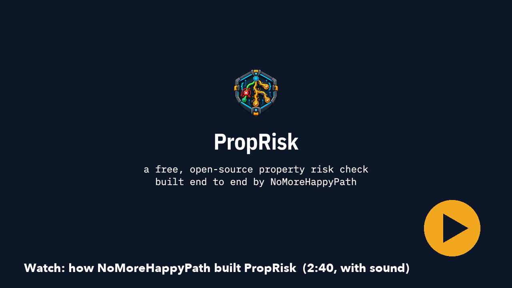

# How PropRisk was built

PropRisk was built end to end by [NoMoreHappyPath](https://nomorehappypath.com), a free,
open-source system that gives one person a whole software company: departments, AI
agents, a rulebook, a 26-step path from idea to release, and controls that make sure
"done" really means done.

Others give you an AI developer. NoMoreHappyPath gives you the software company.

## The team

| Role | Who | What it did |
|---|---|---|
| Owner | A person, not an engineer | Gave the direction, answered the questions, said Go ahead, tried the app and accepted it |
| Builder | Anthropic Claude | Wrote the specification, then built the app |
| Independent reviewer | OpenAI Codex | Reviewed the specification, wrote the tests before any code, tested the whole app |
| CTO | Anthropic Claude | Watched the project and kept it honest |

The builder and the reviewer come from different AI companies on purpose: the one who
checks the work is never the one who did it.

## Part 1: the specification

1. **The owner described it in one paragraph.** Take the Public Data part of PropDesk,
   an existing commercial property product, remove everything else, keep the code and
   languages as they are, store every key in a local SQLite file, no users and no
   sign-in, launch and stop scripts, and document it so a stranger understands what is
   what.
2. **NoMoreHappyPath asked the questions only the owner can answer**: which computers,
   the monthly AI spending limit, the licence, how the app is used, who uses it, what
   happens if it stops or loses data. The answers are written at the top of
   [`SPEC.md`](../SPEC.md).
3. **The builder read the existing code and wrote the specification**: what is kept,
   what is removed, every file that changes, where keys live, the Settings screens, the
   scripts, and a measurable target for every area (security, errors, speed, tests,
   documentation).
4. **The independent reviewer reviewed it.** The first round found a problem, the
   builder repaired it, and the second round passed. The reviewer then checked the
   whole delivery once more, and the board ran its release checks.
5. **The owner read it and said Go ahead.** Nothing is built before that.

## Part 2: the build

6. **The requirements were agreed in the owner's words**: 18 numbered requirements.
7. **The reviewer wrote the tests first**, before a line of code. Every requirement has
   a test, including a failure case.
8. **The tests were locked.** The builder cannot change them.
9. **Every test failed on the empty project**, which proves each test really checks
   something.
10. **The builder planned and built the app**, then ran its own checks.
11. **The board ran the tests itself** and recorded the results. It does not take the
    builder's word for it.
12. **The independent reviewer tested the whole app** and passed it.
13. **The owner tried the app and accepted it.** The owner could also have sent it back.

## What was delivered

- The four Public Data screens and the property map, unchanged in behaviour.
- A Settings menu: what PropRisk needs, keys and secrets, AI spending, and where
  PropRisk works.
- A local key store, launch, stop, keys and test scripts, and a private local database.
- An error log with a reference code on every error the user sees.
- `README.md`, `SECURITY.md`, `docs/ARCHITECTURE.md`, `docs/DATA_SOURCES.md` and
  `docs/MAINTENANCE.md`.

## Try NoMoreHappyPath

NoMoreHappyPath is free and open source:
[github.com/nomorehappypath/nomorehappypath](https://github.com/nomorehappypath/nomorehappypath)
· [nomorehappypath.com](https://nomorehappypath.com)
